# Technical Requirements Document (TRD)
## WhatIfWallet — Native iOS App (Swift / SwiftUI / SwiftData)

**Version:** 2.0
**Date:** September 26, 2026
**Companion Document:** PRD_WhatIfWallet.md
**Supersedes:** TRD_WhatIfWallet.md v1.2 (React Native / Expo)
**Status:** Draft for Review
**Build inputs:** This TRD defines *how* to build. Screen copy, onboarding text and any feature detail not stated here come from PRD_WhatIfWallet.md, so give both documents to whoever (or whatever) builds the app. Section 9.4 lists every screen and state so the app is buildable even where the PRD is silent.
**Revision Note (v2.0):** Re-platformed from React Native / Expo / TypeScript to native **Swift 6 + SwiftUI**, with **SwiftData** for local storage. Product scope, calculation logic, caching policy, backup file format and the Phase II / Phase III plans are unchanged. Section numbers match v1.2 one-to-one so the two documents can be compared side by side. The Android build is dropped (see Section 0).
**Revision Note (v1.2):** Added Section 7.2 — JSON Backup Export & Restore (Import), closing the gap flagged in the PRD's Risks table for recovering local-only data after an uninstall/reinstall or free-tier iOS signing rebuild.
**Revision Note (v1.1):** Added Section 16 (Phase II — Saved Searches; Phase III — Multi-Asset Comparison) and Section 17 (Release Plan Alignment). Sections 1–15 describe the v1 MVP scope.

---

## 0. Summary of Changes from v1.2

**What stays the same:** the retrospective and prospective calculators, asset search, the watchlist, saved scenarios, CSV export, JSON backup and restore, light and dark theming, onboarding, free-tier market data APIs, the provider abstraction, the caching and rate-limit policy, the placeholder image policy, and the local-only, no-backend approach. Phase II (Saved Searches) and Phase III (Multi-Asset Comparison) remain planned later releases.

**What changes:**

| Area | v1.2 (React Native / Expo) | v2.0 (Swift) |
|---|---|---|
| Platform | iOS + Android | **iOS only.** SwiftUI does not target Android |
| Language / UI | TypeScript, React Native | Swift 6, SwiftUI; iOS 26 Liquid Glass design language (Section 9.3) |
| Structured storage | expo-sqlite | SwiftData |
| Key-value settings | AsyncStorage / expo-secure-store | UserDefaults via `@AppStorage` (Keychain if a secret is ever stored) |
| Dependencies | ~20 npm / Expo packages | Apple frameworks only; no third-party packages required for v1 |
| Tooling | Expo Go, EAS Build / Submit | Xcode on a Mac, Xcode Cloud / TestFlight. Development can't happen on Windows |

---

## 1. Technology Stack

Every layer uses an Apple framework, and v1 needs no third-party packages.

| Layer | Choice | Replaces (v1.2) | Notes |
|---|---|---|---|
| Language | **Swift 6** (strict concurrency on) | TypeScript | Compile-time data-race checks; type safety across data layer, API responses and UI |
| UI Framework | **SwiftUI** | React Native + Expo | Declarative views, native controls |
| Minimum OS | **iOS 18** | iOS 15 / Android 8 | iOS 18 is needed for SwiftData's `#Unique` and `#Index` macros (see Open Question #1) |
| Navigation | `TabView` + `NavigationStack` with typed `NavigationPath` routes | Expo Router | Deep links through `.onOpenURL` |
| Local Storage | **SwiftData** (structured scenario / watchlist / cache data) + **UserDefaults via `@AppStorage`** (settings, small key-values) | expo-sqlite + AsyncStorage / expo-secure-store | SwiftData persists to SQLite on device; supports query, sort and filter via `#Predicate` / `SortDescriptor` |
| Charts | **Swift Charts** | react-native-svg + victory-native / gifted-charts | Line, area and multi-series charts; `chartXSelection` for scrubbing |
| State Management | **Observation** (`@Observable` view models) + SwiftData `@Query` | Zustand | Minimal boilerplate, easy to test |
| Networking | **URLSession** with async/await, behind a data-provider abstraction | fetch / axios | See Section 5 |
| CSV Export | Hand-written `CSVExporter` + `ShareLink` / `Transferable` | papaparse + expo-file-system + expo-sharing | See Section 7.1 |
| Backup / Restore | `Codable` + `ShareLink` (export) + `.fileImporter` (restore) | expo-file-system + expo-document-picker | See Section 7.2 — critical for local-only storage recovery after reinstalls / rebuilds |
| Animations | SwiftUI `withAnimation`, `.contentTransition(.numericText())`, `PhaseAnimator` | react-native-reanimated + Moti | Number count-up and transition animations |
| Icons | **SF Symbols** | lucide-react-native | See Section 9.1 |
| Haptics | `.sensoryFeedback` modifier | expo-haptics | |
| Testing | **Swift Testing** + XCTest; **XCUITest** (E2E) | Jest + RNTL; Detox | |
| CI/CD | **Xcode Cloud** (or GitHub Actions on macOS runners) + **TestFlight / App Store Connect** | EAS Build + EAS Submit | Automates build and App Store submission |
| Crash / Analytics (optional, anonymous) | **MetricKit** (no extra data collection), or opt-in **Sentry Cocoa SDK** | Sentry (Expo) | Opt-in; disclose in Privacy Policy if a third-party SDK is enabled |

The IDE is Xcode 26 or later, which ships the Swift 6.2 toolchain and the iOS 26 SDK.

### 1.1 Xcode Project Settings

Create the project from Xcode's **iOS › App** template (Interface: SwiftUI, Storage: None — the container is set up by hand per Section 4.2, Testing System: Swift Testing with XCTest UI Tests), then set:

| Setting | Value | Why |
|---|---|---|
| Product name / Bundle ID | `WhatIfWallet` / `com.<yourname>.whatifwallet` | Bundle ID must be unique to your Apple account |
| iOS Deployment Target | 18.0 | Section 1; Open Question #1 |
| Supported destinations | iPhone only; portrait | iPad uses the iPhone layout in v1 |
| Swift Language Version | Swift 6 | Strict concurrency is on by default |
| Default Actor Isolation | `nonisolated` | Xcode 26 templates may default to `MainActor`; that makes providers, DTOs and calculators main-actor-bound and conflicts with `@ModelActor` background work. Views are `@MainActor` already; view models are marked `@MainActor` explicitly |
| Approachable Concurrency | Yes | Swift 6.2 upcoming-feature bundle; async functions run on the caller's actor unless marked `@concurrent` |
| Base configuration files | `Config/Debug.xcconfig`, `Config/Release.xcconfig` (each does `#include? "Secrets.xcconfig"`) | API keys, Section 5.5 |
| Capabilities | None | No iCloud, push or background modes in v1 |
| Info.plist additions | `FINNHUB_API_KEY`, `TWELVE_DATA_API_KEY`, `ALPHA_VANTAGE_API_KEY` = `$(…)`; `UILaunchScreen` dictionary | Sections 5.5, 8.1 |
| App Icon | Single-size 1024×1024 with Dark and Tinted variants (or an Icon Composer `.icon` file for iOS 26 Liquid Glass icons) | Section 8.1 |

---

## 2. High-Level Architecture

```mermaid
flowchart TB
    subgraph Client["SwiftUI App"]
        UI[UI Layer<br/>SwiftUI Views & Components]
        State[State Management<br/>@Observable View Models + @Query]
        Domain[Domain Logic<br/>Calculators: CAGR, Gain/Loss, Projections]
        DataProvider[Data Provider Abstraction<br/>MarketDataProvider protocol]
        Cache[Local Cache Layer<br/>SwiftData via MarketDataStore @ModelActor]
        ExportSvc[CSV Export & Backup Services]
        Settings[Settings<br/>@AppStorage / UserDefaults]
    end

    subgraph External["External Services (Free-Tier APIs)"]
        StockAPI[Stock Data API<br/>e.g., Alpha Vantage / Twelve Data / Finnhub]
        CryptoAPI[Crypto Data API<br/>e.g., CoinGecko]
    end

    subgraph OS["iOS Layer"]
        FS[App Sandbox File System]
        Share[ShareLink / Share Sheet]
        Picker[fileImporter / Files Picker]
    end

    UI --> State
    State --> Domain
    State --> DataProvider
    DataProvider --> Cache
    DataProvider -->|HTTPS| StockAPI
    DataProvider -->|HTTPS| CryptoAPI
    Cache -->|"@Query"| UI
    UI --> ExportSvc
    ExportSvc --> FS
    ExportSvc --> Share
    ExportSvc --> Picker
    Settings --> UI
```

**Key architectural principle:** The UI and domain logic never call a specific API directly. They call the `MarketDataProvider` protocol. This lets the team swap or add data providers (e.g., if a free API changes terms or is rate-limited) without touching calculation logic or screens.

**Pattern:** MVVM. SwiftUI views bind to `@Observable` view models; lists of persisted data read directly from SwiftData with `@Query`.

### 2.1 Concurrency Model (Swift 6)

- Default actor isolation is `nonisolated` (Section 1.1). Views are `@MainActor` through SwiftUI; view models are declared `@MainActor @Observable final class`.
- Views and view models use the main `ModelContext` (`@Environment(\.modelContext)`) for user edits such as saving a scenario or reordering the watchlist.
- Network fetches, cache writes and backup restores run in a `@ModelActor` (`MarketDataStore`, `BackupService`) with its own `ModelContext`. This keeps large inserts off the main thread.
- Only `Sendable` values cross actor boundaries: plain structs (`QuoteDTO`, `PricePointDTO`, backup DTOs) or `PersistentIdentifier`s, never `@Model` objects.
- `RateLimiter` is an `actor`, so per-provider token buckets are safe under concurrent requests.

---

## 3. Project Structure

```
WhatIfWallet/                           # Xcode project root
├── WhatIfWallet.xcodeproj
├── WhatIfWallet/
│   ├── WhatIfWalletApp.swift           # @main, .modelContainer(for:migrationPlan:)
│   ├── Features/                       # Screens (replaces Expo Router app/ folder)
│   │   ├── Root/
│   │   │   └── RootTabView.swift       # Home / History / Watchlist / Settings tabs
│   │   ├── Home/
│   │   │   ├── HomeView.swift
│   │   │   └── HomeViewModel.swift
│   │   ├── History/
│   │   │   └── HistoryView.swift       # Saved scenarios (@Query)
│   │   ├── Watchlist/
│   │   │   └── WatchlistView.swift     # Favorites
│   │   ├── Settings/
│   │   │   ├── SettingsView.swift
│   │   │   └── BackupSectionView.swift
│   │   ├── Scenario/
│   │   │   ├── RetrospectiveView.swift
│   │   │   ├── ProspectiveView.swift
│   │   │   ├── ResultView.swift
│   │   │   └── ScenarioViewModel.swift
│   │   ├── AssetDetail/
│   │   │   └── AssetDetailView.swift   # Asset detail (chart, metadata)
│   │   └── Onboarding/
│   │       └── OnboardingView.swift
│   ├── Components/                     # Reusable UI components
│   │   ├── AssetSearchField.swift
│   │   ├── PriceChart.swift
│   │   ├── ResultCard.swift
│   │   ├── ScenarioRow.swift
│   │   ├── AppIcon.swift               # SF Symbol wrapper enum (Section 9.1)
│   │   └── ...
│   ├── Data/
│   │   ├── Providers/
│   │   │   ├── MarketDataProvider.swift     # protocol
│   │   │   ├── AlphaVantageProvider.swift
│   │   │   ├── CoinGeckoProvider.swift
│   │   │   ├── FinnhubProvider.swift
│   │   │   ├── TwelveDataProvider.swift     # fallback
│   │   │   └── ProviderRouter.swift         # selects/fallback logic
│   │   ├── Persistence/
│   │   │   ├── Models/                      # @Model classes (Asset, PricePoint, Quote, Scenario, WatchlistItem)
│   │   │   ├── Schema.swift                 # SchemaV1 + SchemaMigrationPlan
│   │   │   ├── MarketDataStore.swift        # @ModelActor price/quote cache
│   │   │   ├── ScenarioRepository.swift
│   │   │   └── WatchlistRepository.swift
│   │   └── Export/
│   │       ├── CSVExporter.swift
│   │       ├── BackupService.swift          # JSON backup export + restore/import
│   │       └── BackupFile.swift             # Codable DTOs
│   ├── Domain/
│   │   ├── Calculators/
│   │   │   ├── RetrospectiveCalculator.swift
│   │   │   ├── ProspectiveCalculator.swift
│   │   │   └── CAGR.swift
│   │   └── Models/                          # Plain Sendable value types
│   │       ├── AssetType.swift
│   │       ├── AssetSearchResult.swift
│   │       ├── QuoteDTO.swift
│   │       └── PricePointDTO.swift
│   ├── Theme/
│   │   ├── Colors.swift                     # Color tokens backed by asset catalog color sets
│   │   ├── Typography.swift
│   │   └── ThemePreference.swift            # system / light / dark (@AppStorage)
│   ├── Utilities/
│   │   ├── DateUtils.swift
│   │   ├── CurrencyFormat.swift
│   │   ├── RateLimiter.swift                # actor
│   │   └── NetworkMonitor.swift             # NWPathMonitor wrapper
│   └── Resources/
│       ├── Assets.xcassets                  # AppIcon, color sets, images, PLACEHOLDER_* (Section 8)
│       ├── ASSET_MANIFEST.md
│       ├── SeedTickers.json                 # offline search fallback
│       ├── Localizable.xcstrings
│       └── PrivacyInfo.xcprivacy
├── Config/
│   ├── Debug.xcconfig
│   ├── Release.xcconfig
│   └── Secrets.xcconfig                     # API keys — gitignored
├── scripts/
│   └── generate-placeholder-assets.swift    # Section 8.3
├── WhatIfWalletTests/                       # Swift Testing unit + persistence tests
└── WhatIfWalletUITests/                     # XCUITest E2E
```

---

## 4. Data Model

### 4.1 Entity-Relationship Diagram

The logical model is unchanged from v1.2. `SETTINGS` is shown for completeness but is stored in UserDefaults, not SwiftData (Section 4.3).

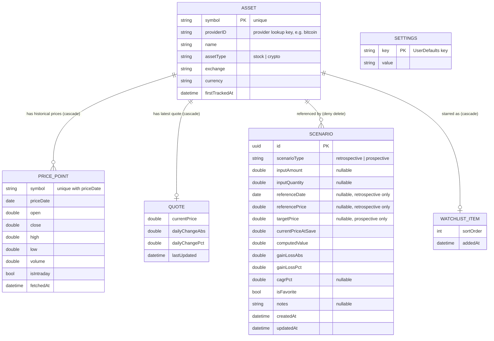

### 4.2 SwiftData Schema (replaces SQLite DDL)

| v1.2 table | SwiftData model | Constraints / indexes |
|---|---|---|
| `asset` | `Asset` | `#Unique([\.symbol])` |
| `price_cache` | `PricePoint` | `#Unique([\.symbol, \.priceDate])`, `#Index([\.symbol, \.priceDate])`; cascade-deleted with its asset |
| `quote_cache` | `Quote` | One-to-one with `Asset`, cascade-deleted |
| `scenario` | `Scenario` | `#Unique([\.id])`, `#Index([\.createdAt])`; asset delete is denied while scenarios reference it |
| `watchlist_item` | `WatchlistItem` | One-to-one with `Asset`, cascade-deleted |
| `settings` | `@AppStorage` keys | See Section 4.3 |

**Models are declared inside their versioned schema** (`SchemaV1.Asset`, …) and exposed to the rest of the app through typealiases. This is required, not stylistic: if Phase II changes `Asset` (it adds `savedSearches`) while `SchemaV1` and `SchemaV2` both point at the same top-level class, the two schema versions hash identically and the migration fails at launch.

```swift
// Data/Persistence/SchemaV1.swift
enum AssetType: String, Codable, Sendable { case stock, crypto }
enum ScenarioType: String, Codable, Sendable { case retrospective, prospective }

enum SchemaV1: VersionedSchema {
    static let versionIdentifier = Schema.Version(1, 0, 0)
    static var models: [any PersistentModel.Type] {
        [Asset.self, PricePoint.self, Quote.self, Scenario.self, WatchlistItem.self]
    }

@Model final class Asset {
    #Unique<Asset>([\.symbol])
    var symbol: String                // display ticker, e.g. "AAPL", "BTC"
    var providerID: String            // provider lookup key, e.g. "AAPL" for Twelve Data, "bitcoin" for CoinGecko
    var name: String
    var assetTypeRaw: String          // AssetType.rawValue; raw strings keep #Predicate simple
    var exchange: String?
    var currency: String = "USD"
    var firstTrackedAt: Date = Date.now

    @Relationship(deleteRule: .cascade, inverse: \PricePoint.asset) var prices: [PricePoint] = []
    @Relationship(deleteRule: .cascade, inverse: \Quote.asset) var quote: Quote?
    @Relationship(deleteRule: .cascade, inverse: \WatchlistItem.asset) var watchlistItem: WatchlistItem?
    @Relationship(deleteRule: .deny, inverse: \Scenario.asset) var scenarios: [Scenario] = []

    var assetType: AssetType {
        get { AssetType(rawValue: assetTypeRaw) ?? .stock }
        set { assetTypeRaw = newValue.rawValue }
    }
    // init omitted
}

@Model final class PricePoint {
    #Unique<PricePoint>([\.symbol, \.priceDate])
    #Index<PricePoint>([\.symbol, \.priceDate])
    var symbol: String                // stored beside the relationship for the unique key
    var priceDate: Date               // start of day, UTC (e.g. 2015-01-01)
    var open: Double?
    var close: Double
    var high: Double?
    var low: Double?
    var volume: Double?
    var isIntraday: Bool = false
    var fetchedAt: Date = Date.now
    var asset: Asset?
}

@Model final class Quote {
    var currentPrice: Double
    var dailyChangeAbs: Double?
    var dailyChangePct: Double?
    var lastUpdated: Date = Date.now
    var asset: Asset?
}

@Model final class Scenario {
    #Unique<Scenario>([\.id])
    #Index<Scenario>([\.createdAt])
    var id: UUID = UUID()
    var scenarioTypeRaw: String
    var inputAmount: Double?
    var inputQuantity: Double?
    var referenceDate: Date?          // retrospective only
    var referencePrice: Double?       // retrospective only
    var targetPrice: Double?          // prospective only
    var currentPriceAtSave: Double
    var computedValue: Double
    var gainLossAbs: Double
    var gainLossPct: Double
    var cagrPct: Double?
    var isFavorite: Bool = false
    var notes: String?
    var createdAt: Date = Date.now
    var updatedAt: Date = Date.now
    var asset: Asset?
}

@Model final class WatchlistItem {
    var sortOrder: Int = 0
    var addedAt: Date = Date.now
    var asset: Asset?
}
}   // end SchemaV1

// Data/Persistence/Schema.swift — the rest of the app only uses these names.
// Phase II repoints them at SchemaV2.*, Phase III at SchemaV3.*.
typealias Asset = SchemaV1.Asset
typealias PricePoint = SchemaV1.PricePoint
typealias Quote = SchemaV1.Quote
typealias Scenario = SchemaV1.Scenario
typealias WatchlistItem = SchemaV1.WatchlistItem

enum WhatIfWalletMigrationPlan: SchemaMigrationPlan {
    static var schemas: [any VersionedSchema.Type] { [SchemaV1.self] }   // + SchemaV2, SchemaV3 later
    static var stages: [MigrationStage] { [] }                           // + .lightweight(fromVersion:toVersion:) per phase
}
```

Every `@Model` class needs an explicit `init` (the macro does not synthesize one); inits take required values and leave defaulted properties alone.

**Container setup** (the `.modelContainer(for:)` view modifier cannot take a migration plan, so the container is built explicitly):

```swift
enum StoreFactory {
    static func makeContainer(inMemory: Bool = false) throws -> ModelContainer {
        let schema = Schema(versionedSchema: SchemaV1.self)
        let config = ModelConfiguration(schema: schema, isStoredInMemoryOnly: inMemory)
        return try ModelContainer(for: schema, migrationPlan: WhatIfWalletMigrationPlan.self,
                                  configurations: config)
    }
}

@main
struct WhatIfWalletApp: App {
    private let result = Result { try StoreFactory.makeContainer() }

    var body: some Scene {
        WindowGroup {
            switch result {
            case .success(let container):
                RootTabView().modelContainer(container)
            case .failure(let error):
                StoreRecoveryView(error: error)      // Section 5.4 — never fatalError on a user's data
            }
        }
    }
}
```

**Rules:**

- **Enums:** Enum values are stored as raw `String`s with computed accessors, because `#Predicate` cannot reliably compare stored enums. This also mirrors v1.2's `CHECK (... IN (...))` columns.
- **Upserts:** `#Unique` makes inserts upsert. Re-fetching a cached price or asset updates the existing row instead of adding a duplicate (replaces SQLite `UNIQUE(symbol, price_date)`).
- **Delete rules:** `.deny` on `Asset.scenarios` matches v1.2's plain `REFERENCES asset(symbol)` on `scenario`. Price, quote and watchlist rows cascade, matching `ON DELETE CASCADE`.
- **Quotes update in place:** Because `Quote` has no unique key, a refreshed quote overwrites the fields of `asset.quote` when one exists. Assigning a new `Quote` to `asset.quote` would orphan the old row, since cascade only runs when the asset is deleted.
- **Timestamps:** Defaults of `Date.now` replace `DEFAULT (datetime('now'))`. `updatedAt` is set explicitly on every edit.
- **Money:** Money fields are `Double` for parity with v1.2's `REAL` columns, and display always goes through `FormatStyle.Currency`. Switching to `Decimal` is Open Question #6.
- **Container:** Created once in `WhatIfWalletApp` as shown above. Previews and tests build the same schema with `ModelConfiguration(isStoredInMemoryOnly: true)`.
- **No iCloud:** CloudKit sync stays off to keep the local-only promise. Turning it on later would require optional or defaulted properties and no `#Unique`, so that choice should be made before the first release (Open Question #8).

### 4.3 Settings (UserDefaults)

| Key | Type | Default | Used by |
|---|---|---|---|
| `theme` | `String` (`system` / `light` / `dark`) | `system` | `.preferredColorScheme` at app root |
| `currencyCode` | `String` | `USD` | Currency formatting |
| `hasCompletedOnboarding` | `Bool` | `false` | Onboarding gate |
| `lastBackupAt` | `Double` (time interval) | none | "Last backup" label and nudge (Section 7.2.5) |
| `backupNudgeDismissedAt` | `Double` | none | Keeps the nudge non-nagging |

In the backup file (Section 7.2.2), `settings.theme` maps to `theme` and `settings.currency` maps to `currencyCode`. Unknown keys in a backup's `settings` object are ignored, and missing keys keep their current values.

---

## 5. Market Data API Strategy (Free-Tier)

### 5.1 Provider Selection

Unchanged from v1.2.

| Need | Primary Provider | Free Tier Limits (approx., verify at build time) | Fallback |
|---|---|---|---|
| Crypto current + historical prices | **CoinGecko API** (`/coins/{id}/market_chart`, `/simple/price`) | No API key required for basic public endpoints; ~10–30 calls/min depending on plan | **CryptoCompare API** |
| Stock current price | **Finnhub** (`/quote`) or **Twelve Data** (`/price`) | Finnhub: 60 calls/min free tier w/ API key. Twelve Data: 800 calls/day free tier | **Alpha Vantage** (`GLOBAL_QUOTE`, 25 calls/day free — used as last resort due to low limit) |
| Stock historical (daily) prices | **Twelve Data** (`/time_series`) or **Alpha Vantage** (`TIME_SERIES_DAILY`) | Twelve Data: 800 req/day; Alpha Vantage: 25 req/day, 5 req/min | Cache aggressively; historical data rarely changes once fetched, so cache indefinitely per date |
| Symbol search/autocomplete | **Twelve Data** (`/symbol_search`) for stocks; **CoinGecko** (`/search`) for crypto | Same as above | Local static seed list of top ~200 popular tickers bundled with app (`SeedTickers.json`) as instant fallback |

> **Note:** Exact provider rate limits and terms change; engineering should verify current limits in each provider's documentation at implementation time and store API keys (where required) via `.xcconfig` build settings (Section 5.5) — never hardcoded in source.

#### 5.1.1 Free-Tier Constraints That Affect Features (verify before coding)

Free tiers change often. As of recent terms, several of them limit exactly what the retrospective calculator needs, so each item below must be checked against current provider docs before the provider code is written:

| Constraint (verify) | Impact | Required handling |
|---|---|---|
| CoinGecko's free / Demo plan limits historical data to roughly the past 365 days | "What if I bought ETH in 2019?" fails on CoinGecko | Route crypto history older than the provider's window to the fallback (CryptoCompare / CoinDesk Data), which offers full daily history |
| Alpha Vantage free `TIME_SERIES_DAILY` returns only the latest ~100 days (`outputsize=full` is premium) | Can't serve old reference dates | Use Twelve Data `/time_series` as the primary stock history source; Alpha Vantage only for recent dates |
| Finnhub's free tier covers quotes, but stock candles (history) are premium | Finnhub can't serve history | Finnhub for current quotes only |
| CoinGecko looks coins up by id (`bitcoin`), not ticker (`BTC`); tickers aren't unique across coins | Wrong or failed lookups | Store `Asset.providerID` from the search result, and always call providers with it |

#### 5.1.2 Non-Trading Days

Stocks have no price on weekends and market holidays. When the user picks such a date, `historicalPrice(on:)` returns the **most recent earlier trading day's close**. The result screen shows the date actually used ("Price as of Fri, Jan 2, 2015"). Crypto trades every day, so this rule never triggers for crypto. Dates before an asset's first available price return `MarketDataError.notFound`, and the date picker's range is limited to `firstAvailableDate...today` once that date is known.

### 5.2 Provider Abstraction Protocol

```swift
// Data/Providers/MarketDataProvider.swift
protocol MarketDataProvider: Sendable {
    func searchAssets(_ query: String, type: AssetType?) async throws -> [AssetSearchResult]
    func currentQuote(for symbol: String, type: AssetType) async throws -> QuoteDTO
    func historicalPrice(for symbol: String, on date: Date, type: AssetType) async throws -> PricePointDTO
    func historicalSeries(for symbol: String, from: Date, to: Date, type: AssetType) async throws -> [PricePointDTO]
}
```

The `symbol` parameters above carry `Asset.providerID` (Section 5.1.1). `AssetSearchResult` is a `Sendable` struct with `symbol`, `providerID`, `name`, `assetType`, `exchange` and `currency`.

A `ProviderRouter` conforms to the same protocol, selecting the correct underlying provider by asset type and applying fallback/retry logic when a call fails or is rate-limited. Each concrete provider decodes its API's JSON with `Codable` into the shared `QuoteDTO` / `PricePointDTO` shapes, so stock and crypto data look identical above this layer.

### 5.3 Caching & Rate-Limit Strategy

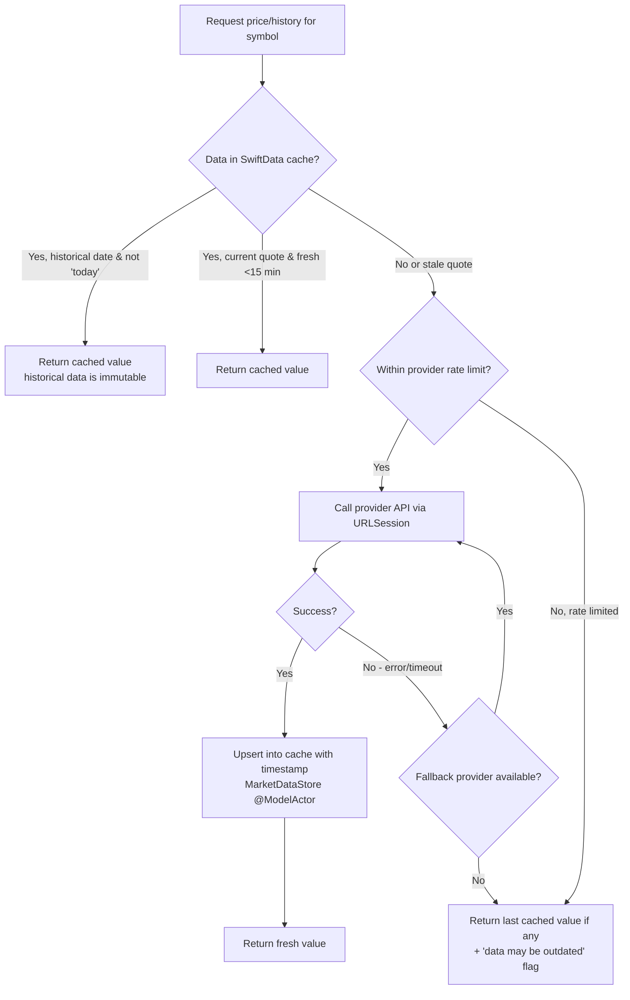

- Historical daily closes are cached **indefinitely** once fetched (they don't change).
- Current quotes are cached with a short TTL (e.g., 15 minutes) to conserve free-tier request budget while keeping data reasonably fresh.
- A lightweight in-memory token-bucket rate limiter (`Utilities/RateLimiter.swift`, an `actor`) throttles outgoing requests per provider to stay under documented free-tier ceilings.
- Search queries are debounced (300–500 ms) client-side via `.task(id: query)` with `try await Task.sleep(for: .milliseconds(400))`; changing the query cancels the previous task automatically.

### 5.4 Error Handling & Offline Behavior

- All API calls use `async throws` with a typed error enum, replacing v1.2's `{ ok: true, data } | { ok: false, error }` results:
  ```swift
  enum MarketDataError: Error, Sendable {
      case offline, rateLimited, notFound, decoding, timeout, server(statusCode: Int)
  }
  ```
- UI displays a persistent "Last updated: [timestamp]" label on any price/chart data (`Text(date, style: .relative)`); if stale (>1 hr for quotes), shows a subtle warning badge.
- If the SwiftData store can't be opened at launch (a corrupt file or a failed migration), the app shows a recovery screen instead of crashing. It offers to restore from a backup file (Section 7.2), or to reset the store after a confirmation.
- `NetworkMonitor` (wrapping `NWPathMonitor`) publishes connectivity. If fully offline, the app still functions using cached scenarios/history/watchlist; new price fetches show a clear "You're offline — showing last saved data" state rather than a generic error.

### 5.5 API Key Management

- Any provider requiring an API key (e.g., Finnhub, Twelve Data) stores the key in `Config/Secrets.xcconfig` (gitignored), exposed to the app through an Info.plist build variable (e.g., `FINNHUB_API_KEY = $(FINNHUB_API_KEY)`) and read at runtime with `Bundle.main.object(forInfoDictionaryKey:)`. CI injects the values from Xcode Cloud / GitHub Actions secrets — never committed to source control.
- Since this is a client-only app (no backend), bundled API keys are technically extractable from the compiled app. Mitigate by:
  - Using only providers whose free tier is designed for public/client use, or
  - Applying conservative client-side rate limiting regardless of server-side limits, and
  - Documenting this constraint for future consideration of a thin proxy backend if abuse becomes an issue (see 5.6).

### 5.6 Optional Future Backend (Not in v1 scope)

If API key exposure or rate-limit pooling becomes a problem post-launch, a minimal serverless proxy (e.g., Cloudflare Workers free tier) could sit between the app and market data providers to hide keys and add a shared cache layer. Because of the provider protocol, this would be one new `ProxyProvider` implementation. This is explicitly **out of scope for v1** per the "local storage only / no backend" requirement, but documented here for future planning.

---

## 6. Core Calculation Logic

### 6.1 Retrospective Calculator

```
quantity = inputAmount ? (inputAmount / referencePrice) : inputQuantity
computedValue = quantity * currentPrice
gainLossAbs = computedValue - (quantity * referencePrice)
gainLossPct = (gainLossAbs / (quantity * referencePrice)) * 100
yearsElapsed = (today - referenceDate) in years (fractional)
cagrPct = ((computedValue / (quantity * referencePrice)) ^ (1 / yearsElapsed) - 1) * 100
```

### 6.2 Prospective Calculator

```
quantity = inputAmount ? (inputAmount / currentPrice) : inputQuantity
currentValue = quantity * currentPrice
projectedValue = quantity * targetPrice
gainLossAbs = projectedValue - currentValue
gainLossPct = (gainLossAbs / currentValue) * 100
pctChangeNeeded = ((targetPrice - currentPrice) / currentPrice) * 100
```

### 6.3 Swift Implementation

Both calculators live in `Domain/Calculators/` as pure functions (no side effects, no SwiftData, no networking), fully unit-testable independent of UI or network layer. `today` is injected so tests are deterministic.

```swift
struct RetrospectiveResult: Sendable, Equatable {
    let quantity, computedValue, gainLossAbs, gainLossPct: Double
    let cagrPct: Double?          // nil when yearsElapsed <= 0
}

enum RetrospectiveCalculator {
    static func calculate(amount: Double?, quantity: Double?, referencePrice: Double,
                          currentPrice: Double, referenceDate: Date,
                          today: Date = .now) -> RetrospectiveResult
}

struct ProspectiveResult: Sendable, Equatable {
    let quantity, currentValue, projectedValue, gainLossAbs, gainLossPct, pctChangeNeeded: Double
}

enum ProspectiveCalculator {
    static func calculate(amount: Double?, quantity: Double?,
                          currentPrice: Double, targetPrice: Double) -> ProspectiveResult
}
```

`yearsElapsed` is computed as `referenceDate.distance(to: today) / (365.25 * 86_400)`. `pow(_:_:)` from Foundation computes CAGR.

### 6.4 Input Validation & Edge Cases

Validation runs in the view model. The Calculate button stays disabled until the inputs are valid, and an inline message under the field explains why.

| Rule | Message / behavior |
|---|---|
| Exactly one of amount or quantity is entered (a segmented "Amount / Quantity" toggle picks which) | Toggle makes the other field hidden, not just empty |
| Amount and quantity > 0, at most 2 decimals for amount, up to 8 for quantity (crypto) | "Enter an amount greater than 0" |
| Reference date ≤ today and ≥ the asset's first available price | Date picker range enforces it; non-trading days per Section 5.1.2 |
| Target price > 0 | "Enter a target price greater than 0" |
| `referencePrice` or `currentPrice` is 0 or missing | No result is computed; show the fetch error state instead of dividing by zero |
| `yearsElapsed` < 1 | CAGR is still computed, but labeled "annualized (under 1 year)"; hidden when the period is under 30 days |
| Numeric input | `TextField(value:format:)` with `.currency(code:)` / `.number`, `.keyboardType(.decimalPad)`, and a toolbar "Done" button, since the decimal pad has no return key |

---

## 7. Data Export & Import (Backup/Restore) Technical Design

### 7.1 CSV Export

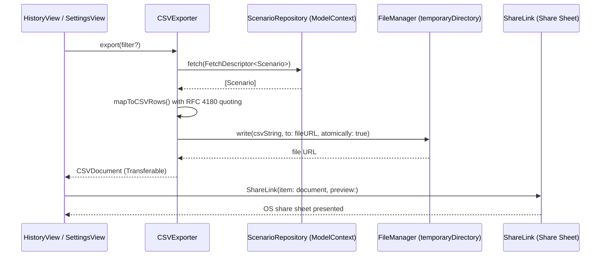

**CSV Columns:**
`id, symbol, assetName, scenarioType, inputAmount, inputQuantity, referenceDate, referencePrice, targetPrice, currentPriceAtSave, computedValue, gainLossAbs, gainLossPct, cagrPct, isFavorite, notes, createdAt`

**File naming:** `whatifwallet_export_YYYY-MM-DD_HHmm.csv`, written to `FileManager.default.temporaryDirectory`, then exposed through a `Transferable` type (`FileRepresentation(exportedContentType: .commaSeparatedText)`) so `ShareLink` can save it to Files / iCloud Drive or share via any installed app.

**Implementation note:** CSV encoding is a small hand-written `CSVExporter` (no dependency). Any field containing a comma, double quote, CR or LF is wrapped in quotes with inner quotes doubled; dates are ISO 8601; `nil` becomes an empty field.

> **Important limitation:** CSV is a **flattened, human-readable** export format designed for viewing/analysis in a spreadsheet. It is intentionally **not** the recommended format for full backup/restore (see 7.2 below), because re-importing a CSV loses type fidelity (e.g., distinguishing `nil` from `0`) and doesn't cover every model (e.g., `Quote`/`PricePoint` are excluded from CSV export by design, since they're just a cache, not user data). CSV remains the right tool for "take my data to Excel/Sheets"; it is not the right tool for "restore my wiped app."

### 7.2 JSON Backup Export & Restore (Import)

This is the feature needed to **recover from the local-only storage risk** flagged in the PRD (Section 10 — Risks & Mitigations) and directly relevant to the 7-day free-signing rebuild cycle: a full-fidelity backup file a user can create *before* a risky rebuild/reinstall, and restore from *after*, without relying on any cloud service.

#### 7.2.1 Design Goals

- **Full fidelity:** captures every user-generated model (`Scenario`, `SavedSearch` [Phase II], `Comparison` [Phase III], `WatchlistItem`, settings, and the `Asset` rows they reference) — explicitly **excluding** `PricePoint` and `Quote`, since those are disposable caches that will simply repopulate from the API after restore.
- **Human-portable:** a single `.json` file the user can AirDrop to themselves, save to iCloud Drive/Files, email to themselves, or store anywhere they like — no account or server required, consistent with the app's local-only philosophy.
- **Versioned:** includes a schema version number so future app updates can detect and migrate older backup files rather than failing silently.
- **Safe by default:** restoring never silently overwrites existing data without explicit user confirmation and a choice of merge strategy (see 7.2.4).
- **Cross-version compatible:** the file format is identical to v1.2's, so a backup from the React Native build (if one exists) restores into the Swift build and vice versa.

#### 7.2.2 Backup File Structure

```json
{
  "backupFormatVersion": 1,
  "appVersion": "1.0.0",
  "exportedAt": "2026-09-06T18:32:00Z",
  "data": {
    "assets": [ { "symbol": "AAPL", "name": "Apple Inc.", "assetType": "stock", "exchange": "NASDAQ", "currency": "USD" } ],
    "scenarios": [ { "...": "full scenario row, one object per saved scenario" } ],
    "savedSearches": [ { "...": "Phase II — included once that feature ships" } ],
    "comparisons": [ { "...": "Phase III — included once that feature ships" } ],
    "watchlist": [ { "symbol": "AAPL", "sortOrder": 0 } ],
    "settings": { "theme": "dark", "currency": "USD" }
  }
}
```

**File naming:** `whatifwallet_backup_YYYY-MM-DD_HHmm.json`

**Swift representation.** `@Model` objects are never encoded directly; `BackupService` maps them to plain `Codable` DTOs:

```swift
struct BackupFile: Codable, Sendable {
    var backupFormatVersion: Int          // currently 1
    var appVersion: String
    var exportedAt: Date
    var data: BackupData
}

struct BackupData: Codable, Sendable {
    var assets: [AssetDTO]
    var scenarios: [ScenarioDTO]
    var savedSearches: [SavedSearchDTO]?  // Phase II; optional so older files decode
    var comparisons: [ComparisonDTO]?     // Phase III; optional so older files decode
    var watchlist: [WatchlistDTO]
    var settings: SettingsDTO
}
```

Scenarios, saved searches and watchlist entries refer to assets by `symbol` in the file. Restore links each one to the matching `Asset` from the same file, upserting assets first. `AssetDTO.providerID` is optional so v1.2 files decode. When it is missing, restore sets it to the symbol for stocks and resolves it through crypto search on the first price fetch. Settings keys map as described in Section 4.3.

`JSONEncoder` uses `.sortedKeys` and `.prettyPrinted`. Dates use a custom strategy that writes ISO 8601 and reads both full ISO 8601 timestamps and date-only strings (`2015-01-01`), which v1.2 used for `referenceDate`.

#### 7.2.3 Export (Backup) Flow

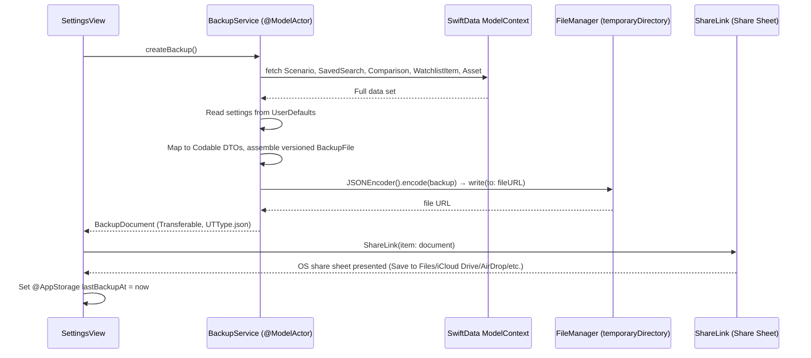

**How the share works:** `BackupDocument` conforms to `Transferable` with `FileRepresentation(exportedContentType: .json) { doc in … }`. That closure is `async`, so it calls `BackupService.createBackup()` and writes the file only when the user picks a destination, and the `ShareLink` can be shown immediately. iOS doesn't report whether the user finished or cancelled the share sheet, so `lastBackupAt` is set when the file is generated. The same pattern backs `CSVDocument`.

#### 7.2.4 Import (Restore) Flow

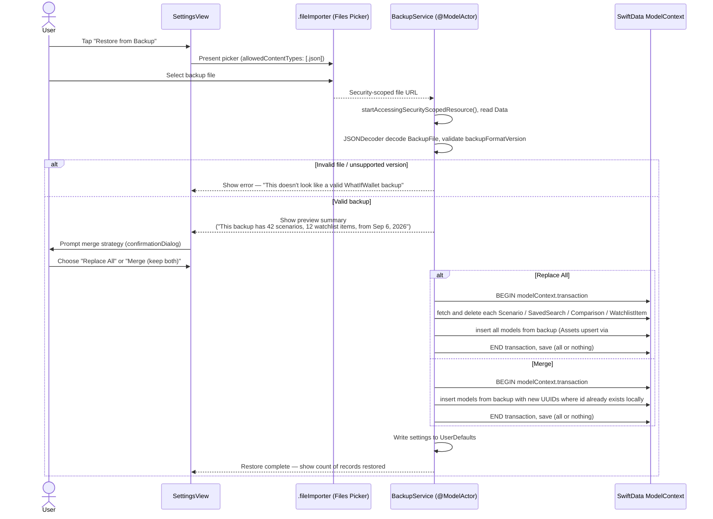

**Merge strategy details:**
- **Replace All** — wipes current local data in the affected models and replaces it entirely with the backup's contents. Appropriate for "I just reinstalled the app and want my old data back exactly as it was."
- **Merge (keep both)** — inserts backup records alongside existing ones, re-generating UUIDs for any `id` collisions so nothing is silently overwritten. Appropriate for "I have some new scenarios since my last backup and want to bring in an older backup without losing recent work." Watchlist items for symbols already on the watchlist are skipped.
- "Replace All" fetches the existing rows and deletes them one by one (`context.delete(_:)`) inside the transaction. It does not use the batch `delete(model:)` API, which can fail on models with to-one inverse relationships.
- Both paths run inside a single `modelContext.transaction { }` with autosave disabled on the restore context, so a failure partway through cannot leave the store in a half-restored state (all-or-nothing). Cached `PricePoint`/`Quote` rows are left untouched.

#### 7.2.5 Recommended User Workflow (Tie-in to Free-Tier iOS Signing)

Given the 7-day free-signing rebuild cycle for personal (free Apple ID) Xcode installs, the Settings screen should surface a lightweight reminder pattern:

- A **"Last backup: [date]"** indicator on the Settings screen (read from `@AppStorage("lastBackupAt")`), similar to the "last updated" price timestamp pattern used elsewhere in the app.
- An optional (dismissible, non-nagging) nudge if the last backup is older than, e.g., 14 days and the user has ≥1 saved scenario — a single `Section` footer line such as *"It's been a while since your last backup"* with a direct button to export one. This is a **passive reminder only**, never a blocking alert or sheet — consistent with the app's low-friction, no-account philosophy.

#### 7.2.6 New Dependency

None. v1.2 needed `expo-document-picker`; SwiftUI's built-in `.fileImporter` modifier and `UniformTypeIdentifiers` cover file selection.

---

## 8. Visual Asset Pipeline & Placeholder Policy

### 8.1 Required Image Assets

All images live in `Resources/Assets.xcassets`. Raster art is supplied at @3x (Xcode generates nothing smaller automatically, so provide @2x too, or use single-scale PDF/SVG vector assets with "Preserve Vector Data").

| Asset | Dimensions | Format | Asset catalog name |
|---|---|---|---|
| App Icon | 1024×1024 single size, with Dark and Tinted variants | PNG | `AppIcon` |
| Launch Screen | Background color + centered logo (Info.plist `UILaunchScreen`) — replaces the 1284×2778 splash | Color set + PDF/PNG | `LaunchBackground`, `LaunchLogo` |
| Onboarding illustration 1–3 | 1170×1000 | PNG/SVG | `onboarding-step-1` (…2, …3) |
| Home hero background | 1170×2532 (subtle, low-contrast) | PNG/HEIC | `backgrounds/home-hero` |
| Retrospective accent background | 1170×800 | PNG/HEIC | `backgrounds/retrospective-bg` |
| Prospective accent background | 1170×800 | PNG/HEIC | `backgrounds/prospective-bg` |
| History empty-state illustration | 800×800 | PNG/SVG | `empty-states/history-empty` |
| Watchlist empty-state illustration | 800×800 | PNG/SVG | `empty-states/watchlist-empty` |

The v1.2 Android adaptive icon is dropped (iOS only).

### 8.2 Visual Theme Direction

Imagery should reflect **"time meets money"** — motifs such as:
- An hourglass or clock face subtly merging into an upward-trending line chart
- Split/parallel timelines suggesting "the path taken vs. the path not taken"
- Soft gradient color palette (deep indigo/navy → teal/emerald, suggesting both nighttime/finance seriousness and growth/money) with tasteful gold/amber accent for highlights and gains, muted red/coral for losses.

These colors are defined once as named color sets (with Any/Dark appearances) in the asset catalog: `BrandIndigo`, `BrandTeal`, `AccentGold`, `LossCoral`, plus semantic tokens (`BackgroundPrimary`, `TextPrimary`, etc.).

### 8.3 Placeholder Policy (Critical Build Requirement)

Because bespoke image generation may not be available in every build environment, **every image reference in code must resolve safely even if final artwork is not yet produced**:

1. All placeholder image sets are prefixed `PLACEHOLDER_` (e.g., `PLACEHOLDER_home-hero`) and are simple, tasteful **gradient PNGs** generated programmatically (no external dependency) using the app's theme colors, so the app never ships with a missing image or a jarring generic stock photo.
2. Views never use raw image-name strings. They go through an `ImageAsset` enum, and every placeholder case carries a matching comment:
   ```swift
   enum ImageAsset: String {
       // TODO(design): Replace with final generated artwork — see TRD Section 8.
       case homeHero = "PLACEHOLDER_home-hero"
       // ...
       var image: Image { Image(rawValue) }
   }
   ```
   Swapping in final art means adding the final image set and changing one enum raw value (or replacing the image set's contents under the same name) — no view code changes. Xcode's generated asset symbols (`Image(.homeHero)`) may be used instead of the enum once names are final.
3. A single manifest file `Resources/ASSET_MANIFEST.md` lists every image asset, its intended final theme/description, dimensions, and current status (`placeholder` | `final`), so design work can be tracked and swapped in without touching component code.
4. Placeholder generation script: `scripts/generate-placeholder-assets.swift` — a Swift script run on macOS (`swift scripts/generate-placeholder-assets.swift`) using CoreGraphics + ImageIO to produce on-brand gradient placeholders (and their `Contents.json`) for every manifest entry still marked `placeholder`, so the app is always visually coherent even pre-final-art. Replaces v1.2's Node/`sharp` script.

---

## 9. UI/UX Technical Implementation Notes

### 9.1 Icon Library Selection

v1.2 chose `lucide-react-native` partly because `@expo/vector-icons` was being deprecated. On native iOS that concern disappears: **SF Symbols** ships with the OS, needs no dependency, and matches system typography.

**Decision matrix:**

| Option | Type | Verdict for WhatIfWallet |
|---|---|---|
| **SF Symbols** (Primary) | System symbol font, 6,000+ glyphs, `Image(systemName:)` | **Selected.** Zero app-size cost; scales with Dynamic Type; built-in weights, outline/`.fill` variants (e.g., `star` / `star.fill` for watchlist favorites), hierarchical/palette rendering and symbol effects (`.symbolEffect(.bounce)`); consistent with the "modern, elegant" design direction from the PRD. |
| Custom SF Symbols (`.svg` symbol templates in the asset catalog) | Exported from the SF Symbols app | Fallback for any glyph SF Symbols lacks (e.g., a specific crypto logo). Inherits weight/scale behavior so it matches system symbols. |
| Lucide (SVG assets in the asset catalog) | Static vector images | Viable if the design team wants to keep the Lucide single-stroke look from v1.2 — but loses Dynamic Type weight matching. Not selected. |
| Phosphor Icons (Swift package) | Vector icons, multiple weights incl. duotone | Candidate for v1.1 if duotone states are wanted and SF Symbols' palette rendering is not enough. |

**Implementation notes:**
- Centralize icon usage behind a thin wrapper (`Components/AppIcon.swift`) — an enum mapping internal names to symbol names (e.g., `.watchlist` → `star`, `.watchlistActive` → `star.fill`). This keeps icon choice swappable later without touching every screen.
- Do not mix multiple icon libraries' *visual style* on the same screen, since inconsistent stroke widths/styles are visible to users even if they can't articulate why.
- Verify every symbol used is available on the minimum iOS version (SF Symbols app shows availability).

### 9.2 Other UI Notes

- **Design tokens** centralized in `Theme/Colors.swift` (backed by asset catalog color sets) and `Theme/Typography.swift`; all components consume tokens rather than hardcoded values, enabling consistent light/dark theming.
- **Theming:** the app root applies `.preferredColorScheme(themePreference.colorScheme)`, where `nil` follows the device setting (replaces `useColorScheme()`) and the manual override is persisted in `@AppStorage("theme")`.
- **Animated results reveal:** `withAnimation(.spring)` plus `.contentTransition(.numericText(value:))` for the gain/loss number count-up, and `.transition(.scale.combined(with: .opacity))` for the card entrance on the Result screen.
- **Charts:** Swift Charts `LineMark` + gradient `AreaMark` for historical price series, with `chartXSelection` scrubbing; pinch/zoom (`chartScrollableAxes` + `chartXVisibleDomain`) deferred to v1.1.
- **Haptics:** `.sensoryFeedback(.impact(weight: .light), trigger:)` on button taps; `.sensoryFeedback(.success, trigger:)` on "Scenario Saved."
- **Accessibility:** All interactive components include `.accessibilityLabel` / `.accessibilityHint` and correct traits; charts provide `.accessibilityChartDescriptor` (Audio Graphs); verify with Accessibility Inspector and VoiceOver before release; use system text styles (`.font(.body)`, etc.) so Dynamic Type works automatically — no fixed point sizes; respect Reduce Motion (`@Environment(\.accessibilityReduceMotion)`) by skipping count-up and draw-on animations.

### 9.3 Modern iOS Design Language (Liquid Glass)

Built with the iOS 26 SDK, the app gets Liquid Glass automatically on standard system components: tab bar, navigation bars, toolbars, sheets, menus and search. The rule is **use standard components first, custom glass second**, so the app looks current on iOS 26 and still looks native on iOS 18.

- **Navigation chrome:** `TabView` built with the `Tab` API (iOS 18) for Home, History, Watchlist and Settings. On iOS 26, add `.tabBarMinimizeBehavior(.onScrollDown)`. Content scrolls under the bars; don't paint opaque backgrounds behind toolbars.
- **Custom glass:** Result and summary cards floating over the hero background use one helper that falls back cleanly:
  ```swift
  extension View {
      @ViewBuilder func cardSurface(cornerRadius: CGFloat = 24) -> some View {
          if #available(iOS 26, *) {
              self.glassEffect(.regular, in: .rect(cornerRadius: cornerRadius))
          } else {
              self.background(.ultraThinMaterial, in: .rect(cornerRadius: cornerRadius))
          }
      }
  }
  ```
  Glass is only for floating controls and cards. List rows and body text stay on solid backgrounds for legibility.
- **Buttons:** Primary actions ("Calculate", "Save Scenario") use `.buttonStyle(.glassProminent)` on iOS 26 and `.borderedProminent` on iOS 18, through the same `#available` pattern. Secondary actions use `.glass` / `.bordered`.
- **Transitions:** `.navigationTransition(.zoom(sourceID:in:))` from a scenario row or watchlist row to its detail (iOS 18). `.scrollTransition` gives a subtle fade and scale on list cards.
- **Motion:** SF Symbol effects (`.symbolEffect(.bounce, value:)` on the favorite star), the number count-up, and chart draw-on are all skipped under Reduce Motion.
- **Standard patterns:** `.searchable` for asset search; swipe actions and `.contextMenu` on rows; `.refreshable` on Watchlist and Asset Detail; sheets with `.presentationDetents([.medium, .large])`; `ContentUnavailableView` for empty, offline and error states; `.redacted(reason: .placeholder)` skeletons while loading.
- **Gain/loss is never color alone:** Every change shows a sign, an arrow symbol (`arrow.up.right` / `arrow.down.right`) and color, for color-blind users.
- **Tint:** App accent color = `BrandTeal`; gains = `AccentGold`; losses = `LossCoral` (Section 8.2).

### 9.4 Screen Inventory & Navigation

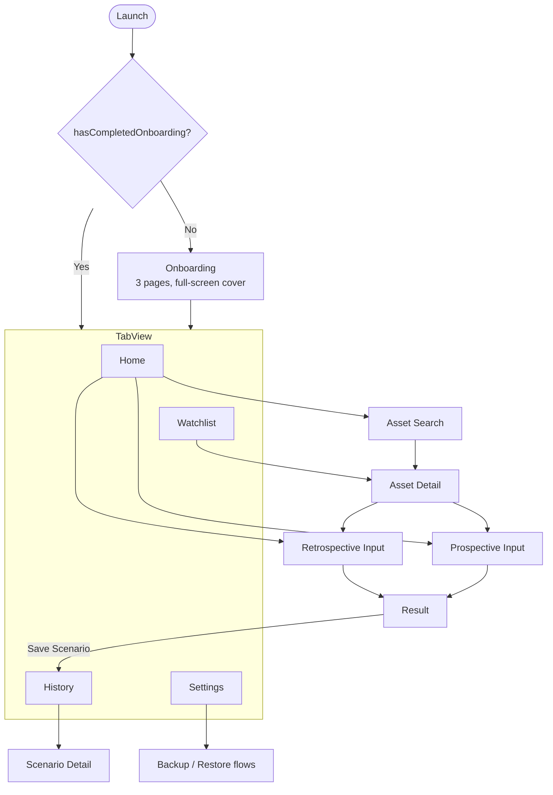

| Screen | Contents | Loading / empty / error states |
|---|---|---|
| **Onboarding** | 3 paged illustrations (Section 8.1) explaining retrospective, prospective and local-only storage; "Get Started" sets `hasCompletedOnboarding` | — |
| **Home** | Large title; hero background; two entry cards: "What if I had invested?" (retrospective) and "What if it hits $X?" (prospective); search field; up to 3 most recent scenarios; watchlist chips | No recent scenarios → hide that section |
| **Asset Search** | `.searchable` field; results grouped Stocks / Crypto with name, ticker, exchange; seed list shown before typing | Loading → skeleton rows; no results → `ContentUnavailableView.search`; offline → seed list + offline banner |
| **Asset Detail** | Price, daily change, "Last updated"; Swift Charts line with range picker (1M / 6M / 1Y / 5Y / Max); star to watch; buttons for both calculators | Skeleton chart; error with Retry; stale badge (Section 5.4) |
| **Retrospective Input** | Asset chip (tap to change), Amount / Quantity toggle, graphical date picker, Calculate | Validation per Section 6.4 |
| **Prospective Input** | Asset chip, Amount / Quantity toggle, target price, live "needs +X%" hint, Calculate | Validation per Section 6.4 |
| **Result** | Count-up hero value; gain/loss abs and % with sign and arrow; CAGR (retrospective); breakdown rows (quantity, reference/current/target price, price date used); mini chart from reference date to today (retrospective); Save Scenario, Edit inputs, Share (text summary via `ShareLink`) | Fetch in progress → skeleton; fetch failure → error with Retry |
| **History** | Scenario list, newest first; filter menu (All / Retrospective / Prospective / Favorites); `.searchable` by symbol or name; swipe to favorite / delete; toolbar Export CSV | Empty → `ContentUnavailableView` + illustration + "Try a scenario" button |
| **Scenario Detail** | Frozen result as saved ("as of [date]"), editable notes, favorite toggle, "Re-run with today's price" (opens the calculator pre-filled) | — |
| **Watchlist** | Rows with price and daily change; Edit mode reorder (`.onMove`); swipe to remove; pull to refresh | Empty → illustration + "Search assets" button; offline → cached values + stale badges |
| **Settings** | Appearance (System / Light / Dark); Currency; **Data**: Export CSV, Back Up Now, Restore from Backup, "Last backup" label + nudge, Clear price cache; **About**: data source attribution (CoinGecko and other providers require it on the free tier), "Not financial advice" disclaimer, privacy policy link, version | — |
| **Store Recovery** | Explains the store couldn't open; Restore from Backup; Reset (confirmation) | Section 5.4 |

---

## 10. Non-Functional Requirements

| Category | Requirement |
|---|---|
| **Performance** | Cold start < 1.5 s on an iPhone 12-class device (v1.2: < 2.5 s); search autocomplete response perceived < 300 ms (cached); History list scrolls at 60 fps with 5,000 scenarios |
| **Offline resilience** | Full read access to saved scenarios/watchlist/cached charts without network; clear offline state for fetch actions |
| **Data privacy** | No PII collected; no network calls other than market data APIs and (optional, disclosed) crash reporting; `PrivacyInfo.xcprivacy` privacy manifest declares required-reason API use (UserDefaults, file timestamps) |
| **Security** | Store uses iOS Data Protection (`completeUntilFirstUserAuthentication`); API keys never committed to source control |
| **Storage limits** | SwiftData (SQLite-backed) store expected to comfortably handle thousands of scenario/cache rows within typical mobile storage constraints; Settings offers "Clear price cache" |
| **Platform support** | iPhone, iOS 18+ (v1.2: iOS 15+, Android 8+); iPad runs the iPhone layout in v1 |
| **Localization** | v1: English only; strings in `Localizable.xcstrings`; currency formatting locale-aware via `FormatStyle.Currency` (replaces `Intl.NumberFormat`); architecture should not block future i18n |
| **App size** | Target < 30 MB installed (v1.2: < 60 MB), mindful of bundling too many high-res image assets |

---

## 11. Testing Strategy

| Test Type | Tooling | Coverage Focus |
|---|---|---|
| Unit tests | Swift Testing (`@Test`, `#expect`, parameterized tests) | Calculators (`RetrospectiveCalculator`, `ProspectiveCalculator`, `CAGR`), CSV mapping and quoting, date utils, currency formatting |
| Persistence tests | Swift Testing + in-memory `ModelContainer` | `#Unique` upserts, delete rules, backup encode/decode round-trip, Replace All and Merge restore, schema migrations |
| View / component tests | SwiftUI `#Preview`s (with in-memory seeded data) for visual review; XCUITest for interaction | Key screens (Search, Result, History list), empty/error/loading states |
| Integration tests | Swift Testing + `URLProtocol` stub (mocked provider) | `ProviderRouter` fallback logic, rate limiter, cache read/write paths, stale-cache flag |
| E2E | XCUITest | Full flow: search → build scenario → save → export CSV; backup → wipe → restore |
| Manual QA checklist | — | Light/dark mode, VoiceOver pass, Dynamic Type sizes, offline mode, rate-limit simulation |

---

## 12. Build & Release Pipeline

```mermaid
flowchart LR
    Dev[Local Dev<br/>Xcode + Simulator / Device] --> PR[Pull Request]
    PR --> CI[CI: SwiftLint + Build + Swift Testing]
    CI --> Merge[Merge to main]
    Merge --> Archive[Xcode Cloud Archive<br/>iOS binary]
    Archive --> InternalTest[Internal Distribution<br/>TestFlight]
    InternalTest --> QA[Manual QA Pass]
    QA --> Submit[Submit via App Store Connect]
    Submit --> AppStore[App Store Review]
    AppStore --> Live[Live on App Store]
```

- **Build configurations / workflows:** `Debug` (local development), a TestFlight workflow (internal testing builds), and a `Release` App Store workflow — configured in Xcode Cloud (or equivalent GitHub Actions jobs using `xcodebuild` + `fastlane`/`altool`). Replaces the EAS `development` / `preview` / `production` profiles.
- **Environment secrets** (API keys) are stored as Xcode Cloud / GitHub Actions secrets and written into `Secrets.xcconfig` at build time; never committed to git.
- **Versioning:** Semantic versioning in `MARKETING_VERSION`; `CURRENT_PROJECT_VERSION` (build number) auto-incremented by CI.
- **Signing:** A paid Apple Developer Program membership ($99/year) is required for TestFlight and the App Store. Free Apple ID signing works for personal device installs but expires every 7 days (see 7.2.5).
- **Hardware:** Building requires macOS + Xcode. Development cannot happen natively on Windows (see Open Question #2).

---

## 13. Component/Module Dependency Diagram

```mermaid
flowchart TB
    Screens[SwiftUI Screens<br/>Features/*] --> Components[Reusable Components]
    Screens --> VMs["@Observable View Models"]
    Screens -->|"@Query"| DB[(SwiftData Store)]
    VMs --> Domain[Domain Calculators]
    VMs --> Repos[Repositories<br/>Scenario / Watchlist]
    Repos --> DB
    VMs --> ProviderRouter[ProviderRouter]
    ProviderRouter --> Providers[Provider Implementations<br/>CoinGecko / Finnhub / TwelveData / AlphaVantage]
    ProviderRouter --> MDStore[MarketDataStore<br/>@ModelActor cache]
    MDStore --> DB
    Screens --> ExportSvc[CSVExporter]
    Screens --> BackupSvc[BackupService<br/>JSON export/import]
    ExportSvc --> Repos
    BackupSvc --> DB
    ExportSvc --> NativeAPIs[ShareLink / Transferable<br/>fileImporter / FileManager]
    BackupSvc --> NativeAPIs
    Screens --> Theme[Theme Tokens / ThemePreference]
```

---

## 14. Key Frameworks & Dependencies (Reference List)

**Apple frameworks (no installation needed):**

```
SwiftUI                 # UI (replaces react-native, expo)
SwiftData               # local storage (replaces expo-sqlite)
Foundation              # URLSession, JSONEncoder/Decoder, FileManager, UserDefaults, FormatStyle
Observation             # @Observable (replaces zustand)
Charts                  # Swift Charts (replaces victory-native / gifted-charts, react-native-svg)
UniformTypeIdentifiers  # UTType.json / .commaSeparatedText (replaces expo-document-picker MIME handling)
CoreTransferable        # Transferable for ShareLink (replaces expo-sharing, expo-file-system)
Network                 # NWPathMonitor offline detection
MetricKit               # optional crash/perf diagnostics
SF Symbols              # icons (replaces lucide-react-native, react-native-vector-icons)
```

The replacement for date-fns is Foundation's `Calendar` and `Date.FormatStyle`. SwiftUI's own gestures and animation replace react-native-gesture-handler and react-native-reanimated.

**Optional Swift packages (Swift Package Manager):**

```
SwiftLint               # build-tool plugin for linting in CI
sentry-cocoa            # only if opt-in Sentry is chosen over MetricKit (Open Question #5)
```

---

## 15. Open Technical Questions (To Resolve Before Dev Start)

1. **Minimum iOS version:** iOS 18 (with `#Unique` and `#Index`) or iOS 17 (wider reach, but uniqueness has to be enforced by hand with composite key strings and fetch-before-insert).
2. **Mac access:** Development needs a Mac with Xcode 26. Choose between a local Mac, a cloud Mac service, or Xcode Cloud only (Xcode Cloud still needs Xcode on a Mac to author code and run the simulator).
3. **Primary stock provider:** Final choice between Twelve Data vs. Alpha Vantage — depends on current (2026) rate limits and historical-depth needs; verify at implementation time since free-tier terms change frequently. *(Carried over from v1.2 #1.)*
4. **Seed ticker list:** Whether to bundle a static "top 200 tickers" seed list for instant offline search fallback, and how often to refresh it. *(Carried over from v1.2 #2.)*
5. **Crash reporting:** Whether anonymous crash reporting ships in v1 and, if so, MetricKit only or the Sentry SDK — given the "minimal data collection" positioning. *(Carried over from v1.2 #4.)*
6. **Money type:** `Double` (parity with v1.2 and simpler predicates) or `Decimal` (exact arithmetic) for stored money fields.
7. **Android:** Whether an Android version is still wanted later. That would need a separate Kotlin app or a shared Kotlin Multiplatform core, because none of the SwiftUI code carries over.
8. **iCloud sync:** Whether it will ever be offered. If so, the SwiftData models must avoid `#Unique` and use optional or defaulted properties from v1.

*Resolved by the move to Swift:* v1.2 #3 (chart library bake-off for low-end Android) — Swift Charts is the single choice and Android is out of scope.

---

## 16. Phase II & Phase III Feature Specifications

These features are **not part of the v1 MVP** (Sections 1–15 above describe the v1 build). They are documented now so the v1 data model and architecture can be built in a way that doesn't need to be reworked later. v1 engineering should keep these in mind when naming models/properties, but should **not** build the UI or logic below until the corresponding phase begins.

### 16.1 Phase II — Saved Searches ("Recall a Thought")

**Feature summary:** Today, a user can only save a *computed* scenario (Section 5.5 of the PRD — "Save Scenario," with a full result). Phase II adds a lighter-weight, earlier save point: the ability to save the **inputs of a "What if I had invested?" or "What if it hits $X?" query itself** — asset + parameters — *before or without* necessarily acting on the full result. This lets a user quickly log "I was curious about NVDA at a $50k target" or "I wondered about investing $500 in ETH back in 2019," and revisit that thought later, distinct from a fully saved/finalized scenario.

**Why this is separate from the existing `Scenario` model:** A saved *scenario* (v1) is a computed, point-in-time snapshot (it freezes `currentPriceAtSave`, `computedValue`, etc., as of when it was saved). A saved *search* (Phase II) is a **live query template** — it re-evaluates against current prices every time the user opens it, rather than freezing a result. This distinction must be preserved in the data model rather than overloading the existing model.

#### 16.1.1 New Data Model — `SavedSearch` (added in `SchemaV2`)

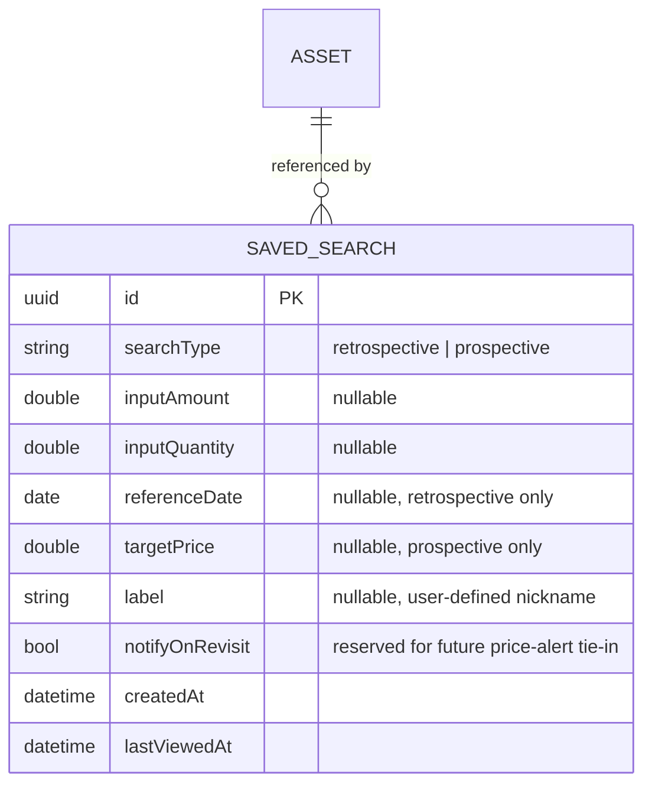

```swift
@Model final class SavedSearch {
    #Unique<SavedSearch>([\.id])
    var id: UUID = UUID()
    var searchTypeRaw: String         // ScenarioType.rawValue
    var inputAmount: Double?
    var inputQuantity: Double?
    var referenceDate: Date?          // retrospective only
    var targetPrice: Double?          // prospective only
    var label: String?                // e.g., "NVDA moonshot idea"
    var notifyOnRevisit: Bool = false
    var createdAt: Date = Date.now
    var lastViewedAt: Date = Date.now
    var asset: Asset?                 // Asset gains: @Relationship(deleteRule: .deny, inverse: \SavedSearch.asset) var savedSearches: [SavedSearch] = []
}
```

`SchemaV2` (version 2.0.0) contains **copies** of all v1 models plus `SavedSearch`, with `SchemaV2.Asset` gaining the `savedSearches` relationship. `SchemaV1` is left untouched. The typealiases in `Schema.swift` are repointed to `SchemaV2.*`, and the migration plan lists `[SchemaV1.self, SchemaV2.self]` with a `.lightweight(fromVersion: SchemaV1.self, toVersion: SchemaV2.self)` stage. Phase III repeats this pattern for `SchemaV3`.

#### 16.1.2 UX Flow

- On the input screen for either calculator (before or after seeing a result), add a secondary action **"Save this idea"** distinct from the primary **"Save Scenario"** action (which remains the v1 frozen-result save).
- A new section, **"Saved Searches"** — integrated as a `Picker(.segmented)` filter within the existing History screen: *Scenarios* vs. *Ideas* — lists saved searches with their **live, recalculated** current value/gain-loss shown each time the screen is viewed, clearly labeled as "as of today" rather than "as saved," to avoid confusion with frozen Scenario results.
- Tapping a saved search re-opens the calculator pre-filled with its parameters, letting the user re-run it, convert it into a full frozen Scenario ("Save Scenario" from here), edit it, or delete it.

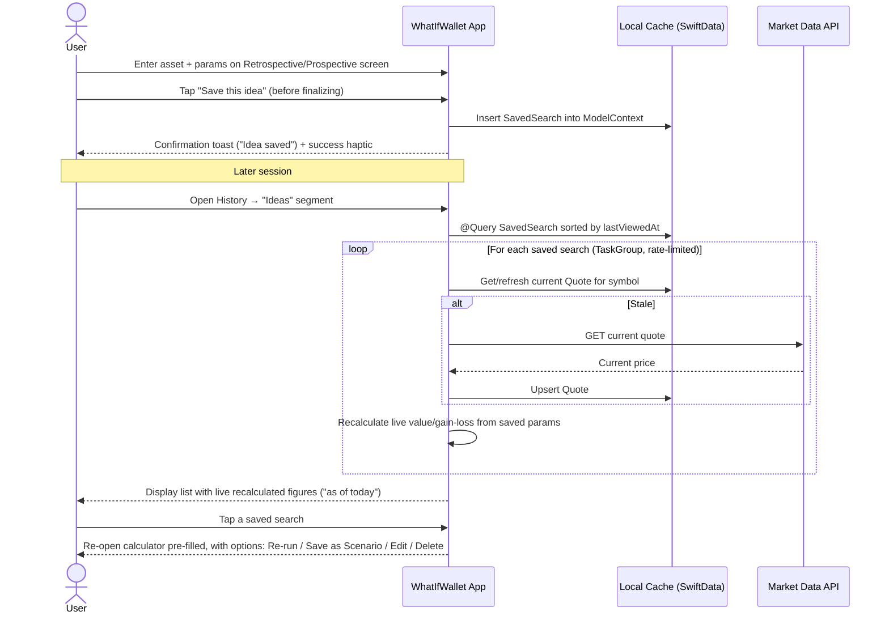

#### 16.1.3 CSV Export Impact

`CSVExporter` should gain a second export type — **Saved Searches export** — with its own column set (`id, symbol, searchType, inputAmount, inputQuantity, referenceDate, targetPrice, label, createdAt, lastViewedAt`) — kept as a separate CSV/export action from the existing Scenario export, since the two represent different kinds of records (live-query template vs. frozen result) and merging them into one file would be misleading.

---

### 16.2 Phase III — Multi-Asset Comparison

**Feature summary:** Allow a user to select **two assets** — stock vs. stock, crypto vs. crypto, or stock vs. crypto — and view their **historical price trends overlaid on a single, elegant line chart**, normalized so the two are visually comparable regardless of differing price scales (e.g., a $50,000 BTC vs. a $180 AAPL share).

#### 16.2.1 Comparison Types

| Comparison | Example |
|---|---|
| a. Stock vs. Stock | AAPL vs. MSFT |
| b. Crypto vs. Crypto | BTC vs. ETH |
| c. Stock vs. Crypto | TSLA vs. BTC |

All three are handled by the **same** underlying comparison engine — the provider protocol (Section 5.2) already normalizes stock and crypto data into the same `PricePointDTO` shape, so no special-casing is needed at the chart or calculation layer, only at the data-fetch routing layer (which already exists via `ProviderRouter`).

#### 16.2.2 The Core UX/Visual Challenge: Differing Price Scales

Plotting raw prices for, say, BTC (tens of thousands of dollars) against AAPL (low hundreds) on a single Y-axis makes one line look flat. The elegant, industry-standard solution — used by tools like Google Finance's and TradingView's comparison charts — is to plot **normalized percentage-change-since-start-date** rather than raw price. This is the approach WhatIfWallet's comparison chart will use.

```
normalizedValue(t) = ((price(t) - price(startDate)) / price(startDate)) * 100
```

Both series are converted to "% change since the selected start date," so both lines start at 0% and diverge naturally — visually answering "which one grew more" at a glance, regardless of each asset's absolute price. A secondary toggle can let advanced users switch to a **dual-axis raw-price view** (left Y-axis for Asset A, right Y-axis for Asset B) for those who want to see actual price levels, but normalized-% is the default and primary elegant view.

#### 16.2.3 Recommended Charting Tool

| Option | Verdict |
|---|---|
| **Swift Charts** | **Recommended.** Native, no dependency; multi-series `LineMark` with `.foregroundStyle(by:)`, gradient `AreaMark` fills, `chartXSelection` for gesture-driven scrubbing, `RuleMark` crosshair and `.annotation` tooltips, and built-in accessibility (Audio Graphs). Renders with native performance. |
| Custom SwiftUI `Canvas` / `Path` | Maximum design control (bespoke curve interpolation, gradient-under-line fill, animated `trim(from:to:)` draw-on) at the cost of more build time. Consider only if Swift Charts cannot achieve a specific bespoke visual. |
| DGCharts (formerly Charts by danielgindi, UIKit) | Mature and feature-rich, including native dual Y axes, but UIKit-based (needs `UIViewRepresentable`) and adds a dependency. Keep as fallback if the dual-axis view proves too awkward in Swift Charts. |

**Decision:** Use **Swift Charts** for the comparison view and for v1's single-asset history chart, so both share styling and components. The comparison chart is the single most visually important screen the PRD calls for ("very elegant tool or visual representation").

**Dual-axis note:** Swift Charts has no built-in second Y axis. The raw-price view scales series B into series A's value range for plotting and draws a custom trailing `AxisMarks(position: .trailing)` whose labels are inverse-mapped back to B's real prices.

**Elegant visual treatment for this screen:**
- Two distinctly colored gradient-stroked lines (e.g., the app's teal/emerald accent for Asset A, gold/amber accent for Asset B — consistent with the palette defined in Section 8.2), each with a soft `LinearGradient` `AreaMark` fill fading to transparent beneath the line.
- A shared vertical crosshair (`chartXSelection` + `RuleMark`) that, on touch/drag, shows both assets' % change and underlying price at that date simultaneously in a small floating `.annotation` tooltip card.
- An animated "draw-on" entrance (both lines animate from left to right on first render) using an animated mask width over the plot area (or `trim` on a custom `Path` overlay), reinforcing the "elegant" requirement from the PRD. Skipped when Reduce Motion is on.
- A compact legend chip pair at the top of the chart (`● AAPL +34.2%` / `● BTC +128.7%`) reflecting the values at the current crosshair position (or at the end of the range, when not touching).

#### 16.2.4 New Data Model — `Comparison` (Optional Saved Comparisons, added in `SchemaV3`)

If comparisons are savable/revisitable (recommended, for consistency with the rest of the app's "save your thinking" philosophy):

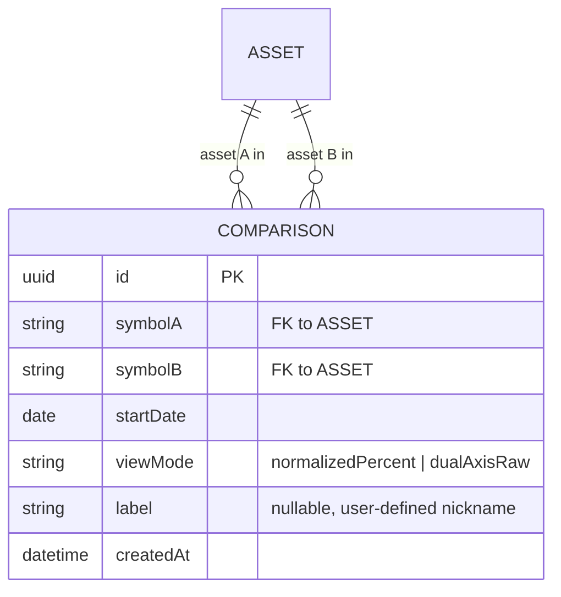

```swift
enum ComparisonViewMode: String, Codable, Sendable { case normalizedPercent, dualAxisRaw }

@Model final class Comparison {
    #Unique<Comparison>([\.id])
    #Index<Comparison>([\.symbolA, \.symbolB])
    var id: UUID = UUID()
    var symbolA: String
    var symbolB: String
    var startDate: Date
    var viewModeRaw: String = ComparisonViewMode.normalizedPercent.rawValue
    var label: String?
    var createdAt: Date = Date.now
}
```

`Comparison` stores symbols rather than two relationships to `Asset`, which avoids two inverse relationships on the same model and mirrors v1.2's `symbol_a` / `symbol_b` columns. The comparison screen upserts both `Asset` rows before saving.

#### 16.2.5 UX Flow

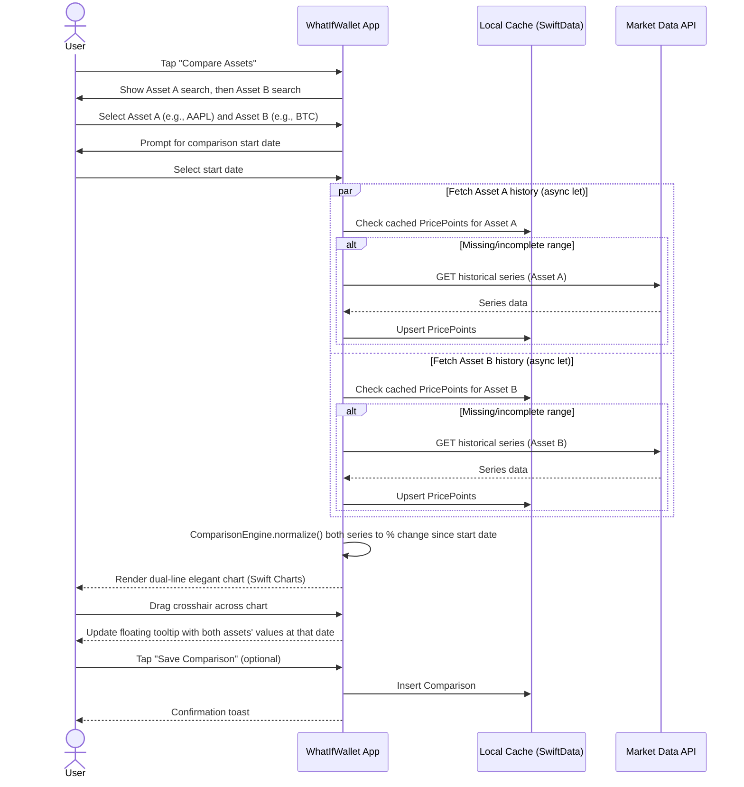

#### 16.2.6 Architecture Impact

```mermaid
flowchart TB
    subgraph Phase3["Phase III Addition"]
        CompareScreen[CompareView]
        CompareEngine[ComparisonEngine<br/>normalize&#40;&#41;]
        ComparisonChart[ComparisonChart<br/>Swift Charts]
    end

    CompareScreen --> AssetSearchExisting[Existing AssetSearchField]
    CompareScreen --> CompareEngine
    CompareEngine --> ProviderRouterExisting[Existing ProviderRouter]
    CompareEngine --> CacheExisting[Existing SwiftData Cache]
    CompareScreen --> ComparisonChart
    CompareScreen --> ComparisonModel[Comparison @Model<br/>SchemaV3]
    ComparisonModel --> CacheExisting
```

This confirms the Phase III feature is **additive** — it reuses the existing `ProviderRouter`, `PricePointDTO` / `PricePoint` model, and SwiftData cache from v1 without modification, and introduces only: one new screen, one new pure calculation module (`ComparisonEngine.normalize()`), one new chart component, and one new (optional) model plus a lightweight schema migration.

#### 16.2.7 New Dependencies for Phase III

None. v1.2 needed `victory-native` (XL) and `@shopify/react-native-skia`; Swift Charts ships with iOS.

#### 16.2.8 Phase III Open Questions

1. Whether normalized comparisons should default to the *longer* asset's full available history or require an explicit user-picked start date every time (leaning toward: always require an explicit start date, since "% change since when" is inherently a user choice, not a default the app should silently assume).
2. Whether to support a 3rd asset in comparison (e.g., AAPL vs. BTC vs. Gold ETF) in a later iteration — out of scope for initial Phase III, but the `Comparison` model's two-symbol design would need revisiting (e.g., a `symbols: [String]` array or a join model) if so.
3. Whether the dual-axis raw-price view is worth building in Swift Charts (custom trailing axis) or should be dropped in favor of normalized-% only.

---

## 17. Updated Release Plan Alignment

This section cross-references PRD Section 14 (Release Plan) with the technical additions above:

| Phase | PRD Scope | Technical Additions (this document) |
|---|---|---|
| **MVP (v1.0)** | Retrospective + Prospective calculators, asset search, local storage, CSV export, JSON backup/restore, light/dark theming, onboarding | Sections 1–15 — `SchemaV1` |
| **Phase II** | Saved Searches ("save this idea" for later recall) | Section 16.1 — `SavedSearch` model (`SchemaV2`), live-recalculation UX, separate CSV export type |
| **Phase III** | Multi-asset comparison (stock vs. stock, crypto vs. crypto, stock vs. crypto) with elegant dual-line historical chart | Section 16.2 — `Comparison` model (optional, `SchemaV3`), normalized % comparison engine, Swift Charts |

---

*End of Technical Requirements Document.*
